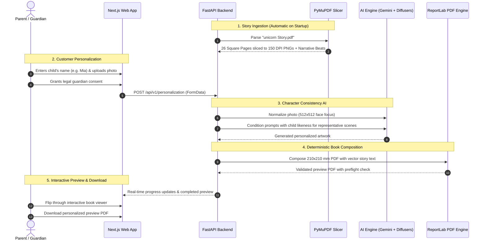

# 🦄 Personalized AI Children's Storybook Platform

A production-grade prototype for creating heirloom-quality personalized children's picture books. Inspired by the customer journey of **KuttyStory** and the soft editorial luxury aesthetics of **Diffrun**.

---

## 📖 What This Project Does

This platform takes an authoritative storybook PDF (like the included 26-page **"The Girl and the Magical Unicorn"**), extracts and preserves the artwork, and lets a parent customize the story:
1. The parent enters the child's name (e.g., *Mia*).
2. The parent uploads a single authorized photo of the child with legal guardian consent.
3. The AI engine generates personalized illustrations featuring the child's recognizable likeness throughout the narrative beats.
4. The parent previews the generated book in an interactive spread viewer.
5. The system produces a downloadable, print-ready 210 × 210 mm PDF with sharp vector typography composed deterministically with ReportLab.

---

## 🔄 Simple End-to-End Workflow



---

## 🌟 Key Features

### 1. Customer Journey
- **Editorial Luxury Homepage**: Soft warm ivory (`#FAF7F2`), dusty rose (`#C98A84`), and deep plum typography inspired by high-end story ateliers.
- **Guided Personalization Wizard**: Drag-and-drop child photo upload, parent/guardian consent confirmation, and instant validation.
- **Interactive Book Viewer**: Full-screen spread navigation with page-by-page progress, prompt inspection, and single-page regeneration if a page needs a redo.
- **Secure PDF Download**: Immediate download of the personalized PDF with preflight-validated resolution.

### 2. Admin Atelier Studio
- **Story Template Library**: Manage story title, price, age category, and published/draft status.
- **Page-by-Page Editor**: View original page thumbnails, edit story narrative text, tweak scene descriptions, and customize AI prompt templates.
- **AI Provider Switcher**: Toggle between Hugging Face Diffusers (hosted serverless), local GPU diffusers, or deterministic mock generation with budget limits.
- **Generation Monitoring**: Real-time job status tracking, completed page counters, and retry controls for failed pages.

---

## 🚀 How to Run the Application

Both backend and frontend can be started with simple commands:

### 1. Start the FastAPI Backend
```powershell
cd backend
pip install -r requirements.txt
alembic upgrade head
python seed_admin.py     # Seeds default admin accounts
python seed_stories.py   # Ingests & configures story catalog
# Or seed everything at once:
# python seed.py
uvicorn app.main:app --reload
```
- API Health Check: `http://127.0.0.1:8000/api/health`
- Interactive API Docs (Swagger): `http://127.0.0.1:8000/docs`
- Configuration: Controlled via `backend/.env` (and template `backend/.env.example`)

#### 🔐 Default Admin Logins
| Email | Password | Name | Role |
| :--- | :--- | :--- | :--- |
| **`admin@kuttystory.com`** | `Admin@123` | Admin Master | admin |
| **`suguna.izonetech@gmail.com`** | `Suguna@123` | Suguna | admin |

*To seed a custom admin:*
```powershell
python seed_admin.py --email custom@admin.com --password YourPassword123 --name "Custom Admin"
```
*To list all existing admin users in database:*
```powershell
python seed_admin.py --list
```

### 2. Start the Frontend
```powershell
cd frontend
npm run dev
```
- Runs automatically on port **`5173`**
- Web Application: `http://localhost:5173`
- Admin Login: `http://localhost:5173/admin_login`
- Configuration: Controlled via `frontend/.env` (and template `frontend/.env.example`)

### 3. Run the Automated Backend Test Suite
```powershell
cd backend
python test_backend.py
```
*Verifies PDF import, ReportLab deterministic PDF composer, and hardware diagnostics.*

---

## 🌐 Application URLs

| Route | Description |
| :--- | :--- |
| **`http://localhost:5173`** | Customer Homepage (Story showcase, atelier process, trust charter) |
| **`http://localhost:5173/personalize/unicorn-story`** | Guided Personalization Wizard & Interactive Book Viewer |
| **`http://localhost:5173/admin_login`** | Atelier Admin Authentication (Login, Register, Password Reset) |
| **`http://localhost:5173/admin`** | Admin Studio (Overview KPIs, Page Editor, AI Settings, Job Monitor) |
| **`http://localhost:8000/docs`** | FastAPI Swagger Interactive Documentation |

---

## 📁 Directory Structure

```text
Baby story/
├── README.md                      # This simple workflow guide
├── sample-assets/
│   └── unicorn Story.pdf          # Original 26-page authoritative source PDF (Untouched)
├── backend/
│   ├── storybook.db               # SQLite database (PostgreSQL compatible)
│   ├── test_backend.py            # Automated end-to-end test suite
│   ├── requirements.txt           # Python dependencies
│   ├── storage/                   # Private secured file storage
│   │   ├── original_pdfs/         # Private copy of original PDF
│   │   ├── source_pages/          # Sliced 150 DPI PNG page illustrations (Pages 1-26)
│   │   ├── child_photos/          # Protected, normalized parent-uploaded photos
│   │   ├── generated_assets/      # Versioned AI-generated illustrations
│   │   ├── previews/              # ReportLab composed preview PDFs
│   │   └── final_books/           # Print-ready final PDFs
│   └── app/
│       ├── main.py                # FastAPI app with auto-import lifespan
│       ├── config.py              # Environment settings & budgets
│       ├── database.py            # SQLAlchemy setup
│       ├── models/                # Database models (User, Story, Page, Job, Asset, Book)
│       ├── schemas/               # Pydantic request/response schemas
│       ├── routers/               # API endpoints (stories, personalization, books, admin, ai)
│       └── services/
│           ├── storage.py         # File storage adapter
│           ├── pdf_importer.py    # PyMuPDF PDF parser & page slicer
│           ├── pdf_composer.py    # ReportLab deterministic 210x210 mm PDF composer
│           ├── job_runner.py      # Background generation & single-page retry worker
│           └── ai/
│               ├── gemini_provider.py      # Google Gemini for scene planning
│               ├── diffusers_provider.py   # Hugging Face Diffusers with hardware checks
│               ├── consistency_engine.py   # Face normalization engine
│               └── mock_provider.py        # Deterministic simulation for offline tests
└── frontend/
    ├── src/
    │   ├── app/
    │   │   ├── page.tsx                    # Customer Homepage
    │   │   ├── layout.tsx                  # Luxury editorial header & footer
    │   │   ├── globals.css                 # Soft editorial luxury design tokens
    │   │   ├── personalize/[slug]/page.tsx # Guided Wizard & Book Viewer
    │   │   └── admin/page.tsx              # Admin Studio & Story Page Editor
    │   └── lib/
    │       └── api.ts                      # Typed TypeScript API client
    └── next.config.ts                      # Reverse proxy rewrites to FastAPI (:8000)
```

---

## 🔒 Child Privacy & Data Safety Charter

1. **Parental Consent Mandatory**: No photograph is processed without explicit legal guardian consent.
2. **Private File Storage**: Child photos and generated books are stored in isolated private directories, never exposed to public buckets.
3. **Deterministic Separation**: Story text is typeset via ReportLab's vector engine, preventing AI models from hallucinating or distorting words.
4. **No Training on Children**: Photos are never used to train public machine learning models.
